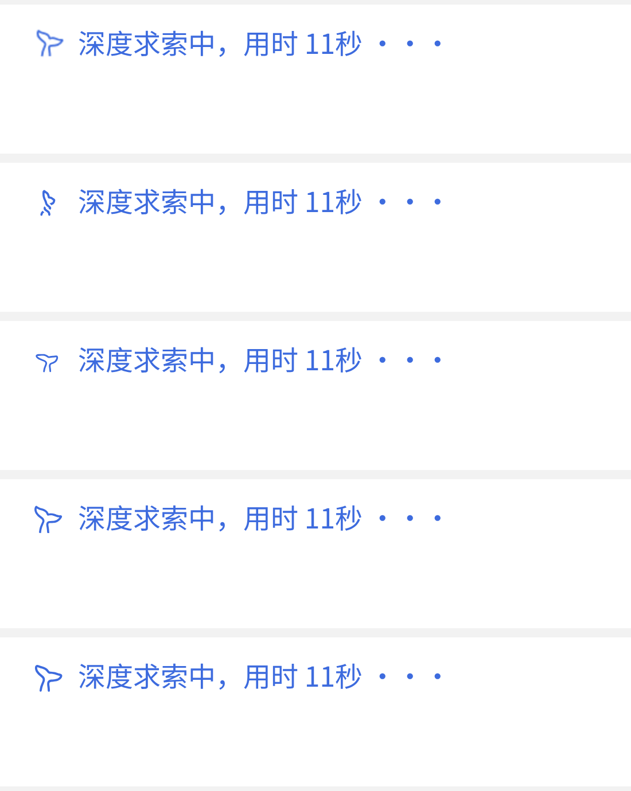

# dsh-whale-random

Random whale animation for the **dsh Web** chat running status — no source patching, one stylesheet.

The stock indicator is a single 28×28 monochrome tail baked into the chat stylesheet as a `mask`. This plugin
appends a stylesheet of its own that targets the same element, repaints it with `currentColor`, and steps through
an **inline SVG sprite** of one of four animations picked at random on every page load.

| variant | source gif | frames used | loop |
| --- | --- | --- | --- |
| `spin` | 360×360, 36 f / 0.72 s | 12 | 0.72 s |
| `turn` | 360×360, 24 f / 0.48 s | 12 | 0.48 s |
| `sway` | 320×320, 150 f / 3.0 s | 15 | 3.0 s |
| `wag` | 360×360, 24 f / 0.72 s | 12 | 0.72 s |

Each chosen frame is traced to vector (potrace) and packed into one sprite SVG; the animation moves
`mask-position` in `steps(1, end)` keyframes, so the browser only ever moves a mask — no JS timer, no DOM mutation.



Rows top to bottom: stock indicator, then `spin`, `turn`, `sway`, `wag` (harness screenshot, 4× DPR).

## Install

```bash
dsh plugin --profile web add github:std-external/dsh-whale-random
```

Then restart dsh (or hard-refresh the Web page). The variant is chosen once per page load; reload to reroll.

Remove it again with:

```bash
dsh plugin --profile web remove dsh-whale-random
```

## How it works

1. `dsh.client.bundle` inserts one client plugin into the profile (`cordis.patch.yml`).
2. `lib/client.js` exports `apply(ctx)`; it picks one variant, creates a `<style data-plugin="dsh-whale-random">`
   tag, and appends it to `document.head` (removed again on dispose).
3. The stylesheet only overrides the decorated span inside the running row:

   ```css
   [data-chat-running] span[aria-hidden="true"] > span:first-child { /* original mask */ }
   ```

   with a sprite mask, `mask-size: <frames*100>% 100%`, and a `mask-position` keyframe animation.

## Caveats

- It depends on the current running-row markup (`data-chat-running` + the aria-hidden icon span) and on the
  browser supporting `mask-mode: alpha`. If dsh changes that markup the rule stops matching and the stock
  indicator simply keeps working — nothing breaks.
- `prefers-reduced-motion: reduce` and forced-colors keep the stock behaviour: no animation, static SVG tail.
- The plugin only replaces the *look*; it cannot tell thinking from tool calls, because that row carries no
  such state (the stock indicator does not distinguish them either).

## Verification (Chromium, Playwright)

`test/check.mjs` loads the real chat stylesheet and running-row markup, then installs the bundle's stylesheet per variant:

- `CSS.supports('mask-mode', 'alpha')` → `true`, so the guarded block applies exactly like the stock one;
- the decorated span reports `mask-size: 1200% 100%` (12-frame sprites) / `1500% 100%` (15-frame) and
  `mask-position` stepping `0% → 9.09% → 27.27% → 45.45%` over time — frames advance;
- calling the shipped `apply({})` installs exactly one `<style data-plugin="dsh-whale-random">` tag and picks a
  variant at random (`turn` in the recorded run).

## Development

```bash
node scripts/build-css.mjs   # traces frames, rewrites src/variants.json
node -e "..."                # see test/check.mjs for the Playwright harness
```

`scripts/build-css.mjs` expects the extracted gif frames under `/var/cache/orange-tmp/whale/g1…g4`
(any frame directory with 001.png… works; adjust the constants at the top).

## License

MIT. The whale artwork belongs to DeepSeek Harness; this plugin only re-renders it locally and is not
affiliated with or endorsed by DeepSeek.
